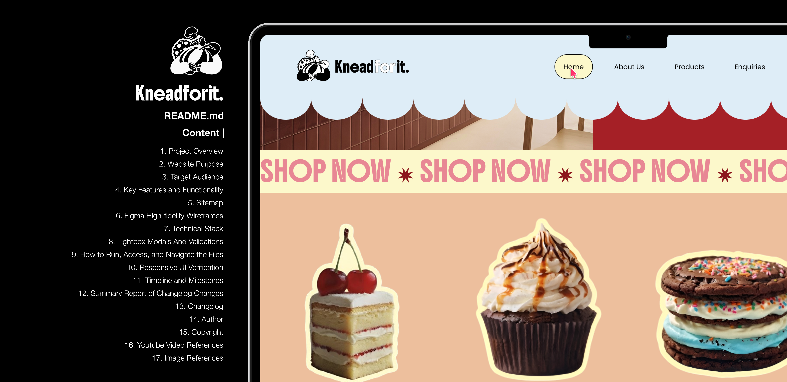
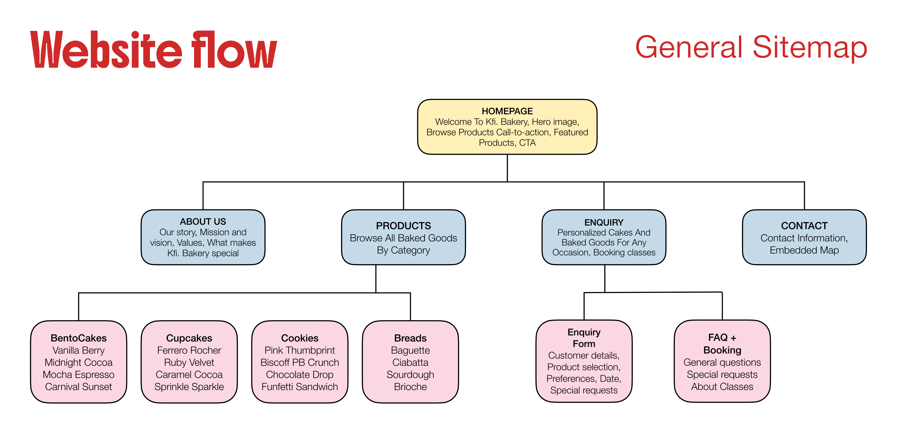
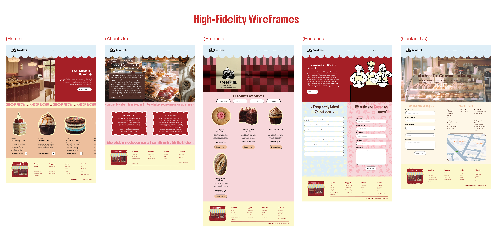
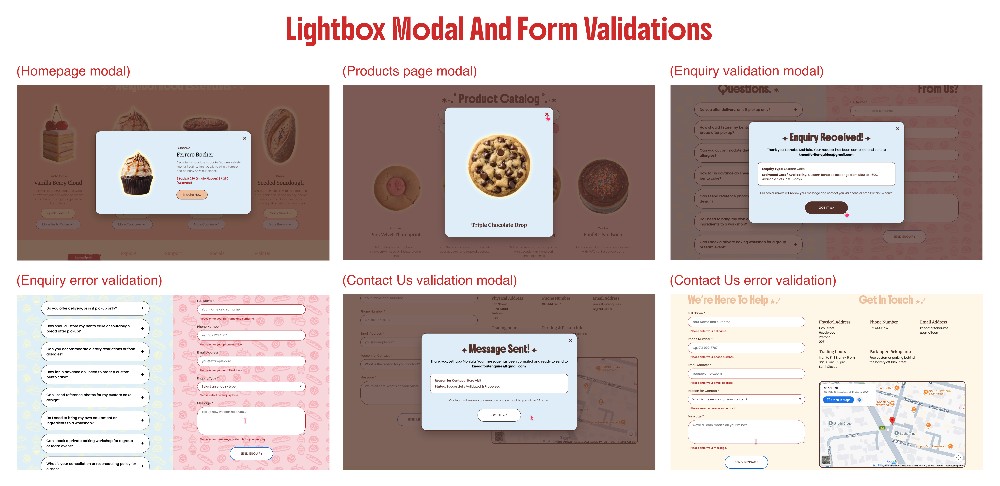
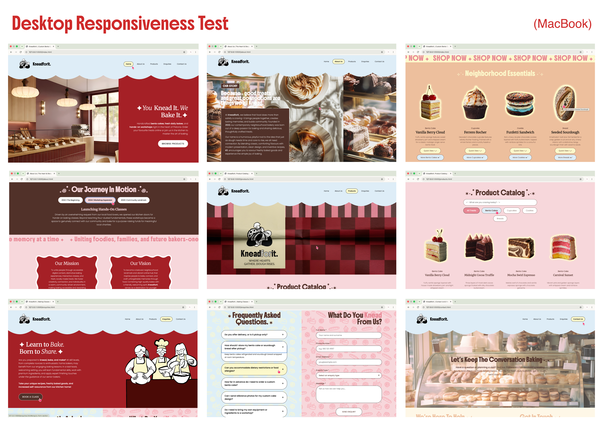
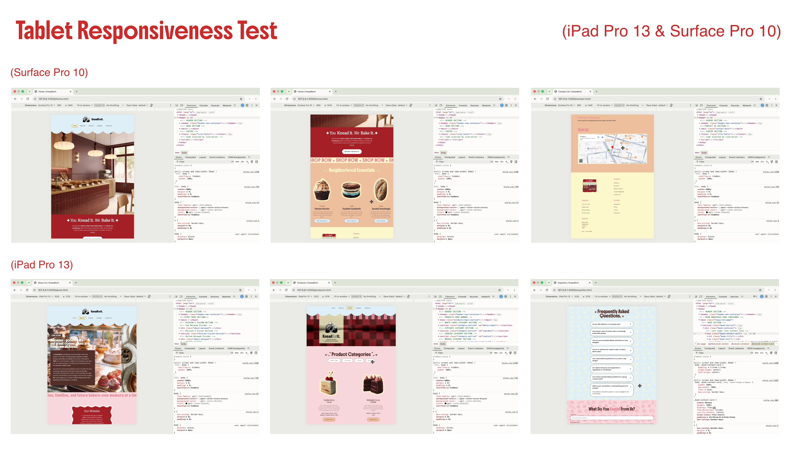
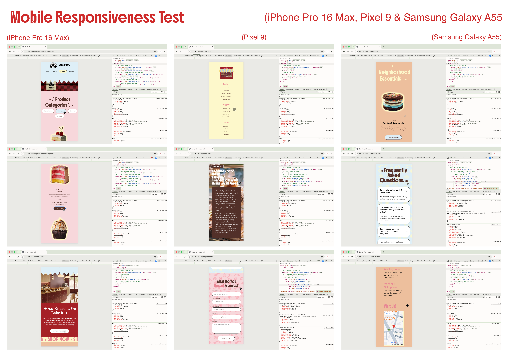

# Welcome to Kneadforit. Bakery (๑ᵔ⤙ᵔ๑)

## 1. Project Overview

**Kneadforit.** (shortened as **Kfi.**) is a contemporary, neighbourhood-focused bakery based in Hazelwood, Pretoria. Established in 2022, the brand combines traditional baking with modern aesthetics, offering freshly baked bento cakes, sourdough breads, cupcakes, cookies, and interactive baking classes.

### Mission
To bring people together through easily available digital material, unique baking experiences, engaging classes, and locally produced, freshly baked goods. We make baking accessible and fulfilling for people of all skill levels by fostering creativity, connection, and originality in a welcoming, community-driven setting.

### Vision
To become a cherished local landmark and a thriving online community that encourages people to interact, bake, and create lifelong memories via food. Kneadforit combines superior baked goods with a warm, inviting atmosphere. acts as a venue for families, bakers, and younger foodies.

## 2. Website Purpose
The website's main goals are to highlight Kneadforit's product line, allow local clients to schedule baking classes and put special order requests, and offer crucial company details (address, operating hours, and communication channels) in an easy-to-use, responsive design.

## 3. Target Audience

- **Local Community & Families**
- **Young Foodies & Trendseekers** 
- **Baking Enthusiasts**

## 4. Key Features and Functionality

### Home Page
- **Continuous Image Slider |** Behind-the-scenes information and bakery displays are showcased on a smooth horizontal backdrop slider.
- **Brand Story Card |** An interactive floating card explaining the origins and significance of Kneadforit.
- **Mission & Vision Wavy Cards |** Personalized cards with text marquee separators at the top and bottom.
- **Dynamic Featured Catalog & Lightbox Modals |** Programmatically rendered featured bento cakes, cookies, and sourdough cards featuring responsive quick-view click events and 500px x 600px interactive lightbox inspections.

### About Us
- **Continuous Image Slider |** Behind-the-scenes information and bakery displays are displayed on a smooth horizontal backdrop slider.
- **Brand Story Card |** An interactive floating card explaining the origins and significance of Kneadforit.
- **Mission & Vision Wavy Cards |** Personalized cards with text marquee separators at the top and bottom.
- **Interactive Milestone Tabs |** Clickable milestone tabs allowing users to explore historical brand growth and company chapters dynamically.

### Products
- **Category Navigation & Real-time Search |** Instant product filtering by category (Bento Cakes, Cupcakes, Cookies, Breads) and live keyword search bar querying product names and descriptions.
- **Product Grid & Lightbox Integration |** Customizable cards linking directly to enquiries, pricing tiers, detailed descriptions, and isolated product modal previews.

### Enquiries
- **Interactive FAQ Accordion |** Collapsible accordions made entirely of HTML and CSS with spinning `+`/`x` indication symbols.
- **Robust Form Validation & AJAX Simulation |** Client-side JavaScript validation using Regex patterns for South African phone numbers and email addresses, minimum character length checks for messages, inline error notices, and dynamic input border feedback.
- **Custom Confirmation Modal |** Dynamic success modal popups that compile recipient email routing (`kneadforitenquires@gmail.com`) and display contextual pricing or availability feedback depending on the selected enquiry type.

### Contact
- **Optimized Hero Banner & Layout |** Responsive bakery background counter hero image (`bakery.png`) with custom opacity and dark espresso typography matching visual design specifications.
- **Location & Operating Hours |** Clear presentation of the Hazelwood, Pretoria physical address, direct phone lines, contact emails, trading hours, and parking information arranged in a 3-column grid.
- **Embedded Google Map |** An interactive Google Maps `<iframe>` integration providing visual directions to 16th Street, Hazelwood.
- **Validated Contact Form & Confirmation Flow |** Fully validated general contact form featuring reason-for-contact selectors, inline error handling, and a custom success confirmation modal.

### Search Engine Optimization (SEO)
- **Unique Page Metadata |** Tailored `<title>` tags, meta descriptions, and keywords implemented across all 5 site pages alongside Open Graph social sharing tags.
- **Crawler & Indexing Control |** Root `robots.txt` instructions and a complete `sitemap.xml` file mapping canonical URLs, change frequencies, and priority weights.

## 5. Sitemap

## 6. Figma High-fidelity Wireframes

## 7. Technical Stack

### Core Technologies
- **HTML5 |** Semantic markup (`<header>`, `<main>`, `<article>`, `<section>`, `<footer>`, `<picture>`) for structured content, accessibility, and improved screen-readability.
- **CSS3 |** Custom centralized stylesheet (`css/style.css`) utilizing Flexbox, CSS Grid layouts, custom properties (CSS variables), keyframe animations (`@keyframes horizontalSlide`, `@keyframes marquee-scroll`), and responsive media queries.
- **JavaScript (ES6+) |** Native client-side scripting for dynamic product catalog rendering, search/filtering, quick-view lightbox modals, Intersection Observer scroll animations, Regex-based form validation, and AJAX-style asynchronous submission simulation.

### External Assets & Fonts
- **Google Fonts API |** Imported typography weights for primary, secondary, and accent styles (`Boldonse`, `Merriweather`, and `Poppins`).
- **Embedded Maps |** Interactive Google Maps `<iframe>` integration for physical store location rendering and directions.

### Image & Asset Optimization
- **WebP Image Format |** `.webp` media encoding for optimized site performance and faster load times.
- **HTML5 `<picture>` Elements |** Multi-format image fallback strategy featuring `.webp` graphics with `.png` and `.jpg` fallbacks.
- **Scalable Vector Graphics (SVG) |** Inline vector graphics for decorative UI elements (such as the scalloped banner divider).

### Search Engine Optimization (SEO) & Indexing
- **Meta Tags & Open Graph |** Unique page titles, meta descriptions, keywords, and Open Graph social sharing tags across all site pages.
- **Crawler Directives (`robots.txt`) |** Root crawler instructions managing search engine indexing and sitemap references.
- **XML Sitemap (`sitemap.xml`) |** Canonical URL mapping, last modified tracking, change frequencies, and priority weights for enhanced search discovery.

### Developer Tools & Version Control
- **Git |** Distributed version control system for tracking incremental changes and feature updates.
- **GitHub |** Cloud-based repository hosting and changelog tracking via Conventional Commits.
- **Visual Studio Code |** Primary IDE equipped with Live Server for local development and testing.

## 8. Lightbox Modals And Validations

## 9. How to Run, Access, and Navigate the Files

### Running the Website Locally
**9.1. Clone the Repository:**
- git clone [https://github.com/Lethabomohlala/ST10093005_LETHABO_MOHLALA_WEDE5020_POE.git](https://github.com/Lethabomohlala/ST10093005_LETHABO_MOHLALA_WEDE5020_POE.git)

**9.2. Open the Project Directory:**
- cd ST10093005_LETHABO_MOHLALA_WEDE5020_POE

**9.3. Launch in Browser:**
- Double-click `index.html` directly from your file explorer to launch it in any modern web browser.
- Alternatively, if using VS Code, install the Live Server extension, right-click `index.html`, and select Open with Live Server.

### Code Base Architecture & Navigation

**9.4. HTML Page Documents (Root Directory):**
- index.html | Primary landing page featuring hero banners, continuous marquee strip, and dynamic featured products.
- about.html | Brand story, infinite showcase slider, mission & vision cards, and interactive milestone tabs.
- products.html | Complete catalog with category filters, real-time search, and product lightbox modals.
- enquiries.html | Baking workshop details, interactive FAQ accordions, client-side validated enquiry form, and response confirmation modal.
- contact.html | Bakery hero banner, Hazelwood store location details, trading hours, validated contact form, confirmation modal, and embedded Google Map.

**9.5. Styling System (CSS):**
- style.css | Central stylesheet containing design variables (color palette, typography pairings), responsive layout grids, keyframe animations `(@keyframes horizontalSlide, @keyframes marquee-scroll, @keyframes marquee-infinite)`, component modal overlay styles, and mobile viewport media queries.

**9.6. Core Application Logic (JavaScript):**
- script.js | Centralized master JavaScript file handling dynamic product catalog rendering, real-time search/filter algorithms, quick-view lightbox modals, Intersection Observer scroll animations `(animate-on-scroll)`, Regex form validation engines, and asynchronous AJAX submission simulation handlers for both `enquiries.html` and `contact.html`.

**9.7. SEO & Crawling Assets (Root Directory):**
- robots.txt | Instructions for search engine crawlers regarding page indexing and sitemap discovery.
- sitemap.xml | XML sitemap mapping canonical URLs, last modified timestamps, change frequencies, and priority values across all 5 site pages.

**9.8. Media Assets (images/ directory):**
- Stores all graphical assets formatted with optimized `.webp` media encoding alongside `.png` and `.jpg` fallback images.

**9.9. Documentation & Logs:**
- README.md | Comprehensive project documentation, architectural overview, technical stack, timeline milestones, and navigation guide.
- CHANGELOG.md | Version release history tracking incremental feature updates and bug fixes following Semantic Versioning standards.

**9.10. Making Changes and Pushing Updates:**

##### To update code or content via VS Code Terminal:
- Edit target files: Save changes in your HTML or CSS files.- Stage changes | git add .
- Commit with detailed message | git commit -m “short description" -m "- Detailed line 1
Detailed line 2.”
- Push to remote repository | git push origin main

## 10. Responsive UI Verification

### Running tests on Desktop (MacBook)

### Running tests on Tablets (iPad Pro 13 & Surface Pro 10)

### Running tests on Mobile Devices (iPhone Pro 16 Max, Pixel 9 & Samsung Galaxy A55)

## 11. Timeline and Milestones

| Milestone| Deadline | Task Description | Status |
| :--- | :--- | :--- | :--- |
| **Part 1** | **14 August 2026** | **Initial Website Wireframing & Structural Build** | **COMPLETED** |
| | 03 – 05 August 2026 | Planning & Foundation | COMPLETED |
| | 06 – 08 August 2026 | Research & Content Gathering | COMPLETED |
| | 10 – 14 August 2026 | HTML Structure Development | COMPLETED |
| **Part 2** | **18 September 2026** | **Full Visual Rebrand & CSS Responsive Styling** | **COMPLETED** |
| | 03 – 04 September 2026 | Rebranding and Visual UI Design | COMPLETED |
| | 07 September 2026 | Updating HTML structures for all pages | COMPLETED |
| | 09 – 12 September 2026 | CSS styling for pages, fixes to HTML structures | COMPLETED |
| | 16 – 18 September 2026 | Responsiveness of Website pages + testing | COMPLETED |
| **Final Part** | **02 November 2026** | **v3.0.0 Dynamic Interactivity, JS Validation & SEO Implementation** | **COMPLETED** |
| | 20 – 25 October 2026 | Dynamic DOM Manipulation, Product Catalog & Search/Filter | COMPLETED |
| | 26 – 28 October 2026 | Interactive Lightbox Modals & Site-wide Scroll Animations | COMPLETED |
| | 29 – 31 October 2026 | Client-Side JS Validation, Custom Confirmation Modals & Layout Fine-Tuning | COMPLETED |
| | 01 – 02 November 2026 | Search Engine Optimization (SEO), Metadata, robots.txt, sitemap.xml & Final Part Submission | COMPLETED |

## 12. Summary Report of Changelog Changes

### Version Release History 

| Version | Date | Core Changes |
| :--- | :--- | :--- |
| **v1.0.0** | 2026-08-14 | Initial website repository launch, basic HTML structures, and baseline content files. |
| **v2.0.0** | 2026-09-18 | Full visual rebrand to Kneadforit., introduction of `style.css`, WebP asset integration, semantic improvements, and multi-device responsive design. |
| **v3.0.0** | 2026-11-02 | Dynamic JavaScript integration, search/filtering catalog, client-side Regex form validation, simulated AJAX submission & confirmation modals, complete responsive Contact layout, and full SEO setup (meta tags, `robots.txt`, `sitemap.xml`). |

* **Rebranding |** Renamed from Knead You to Kneadforit. (Kfi.) to establish a distinct, trademark-compliant brand identity.
* **Visual Redesign & CSS Integration |** Replaced static image banners with a centralized stylesheet (`css/style.css`), implementing responsive flex/grid layouts, web fonts, custom color palettes, and styled components.
* **Enhanced Functionality |** Introduced animated marquee tickers, interactive CSS accordion FAQs, responsive multi-column footers, and embedded Google Maps.
* **Dynamic Interactivity & Modals |** Developed dynamic catalog rendering via centralized `script.js`, interactive quick-view product lightbox modals, and smooth `IntersectionObserver` scroll animations across all pages.
* **Form Validation & AJAX Simulation |** Added robust client-side JavaScript validation (Regex email/phone patterns, length checks) for both `enquiries.html` and `contact.html`, complete with inline error messaging and custom confirmation modals.
* **SEO & Crawler Optimization |** Implemented targeted page meta tags (Title, Description, Keywords, Open Graph), site-wide H1–H3 heading hierarchy alignment, image alt text optimization, and created root `robots.txt` and `sitemap.xml` files.
* **Bug Fixes |** Fixed broken anchor links across footers to properly direct custom enquiries to `enquiries.html#enquiry-form-section`, aligned section slide-up animations site-wide, and corrected contact hero background positioning and overlay styling.

## 13. Changelog

All notable changes to the KY Bakery website are documented here.

### [1.0.0] - 2026-08-14

#### Added
- Created the initial website repository.
- Added the homepage design.
- Added the About Us page.
- Added the Products page.
- Added product information and categories.

#### Updated
- Updated the homepage design.
- Updated the About Us page design.
- Updated the Products page design.
- Added further website improvements and refinements.

#### Fixed
- Resolved merge conflicts between the local and remote repository.
- Removed unnecessary `.DS_Store` file.

#### Commits
- Initial Commit
- Delete `.DS_Store`
- Updated homepage design
- Merge remote main and resolve conflicts
- Updated about us page design
- Updated products page design
- Second Commit
- Third Commit

### [2.0.0] - 2026-09-18

#### Added

##### Home:
- Rebranded official store identity across homepage to **Kneadforit.**
- Integrated Google Fonts (`Boldonse`, `Merriweather`, and `Poppins`) and external stylesheet (`css/style.css`).
- Added new visual image assets including bakery interior, storefront illustration, and updated product shots.
- Added responsive `<picture>` tags with a `.webp` fallback.
- Added decorative SVG scalloped header and animated infinite marquee strip.
- Created "Neighborhood Essentials" product scroll grid using `<article>` cards.
- Created `css/style.css` for central site styling, typography, and responsive layout management.
- Customized CSS design variables for brand color scheme and Google Fonts integration.
- Added keyframe animations (`marquee-infinite`) for continuous banner scrolling.
- Added CSS Grid layout for multi-column footer navigation and contact details.
- Added media queries to ensure full mobile and tablet responsiveness across break points.

##### About Us:
- Rebranded official store narrative across About Us page to **Kneadforit.** and **Kfi.**
- Created continuous horizontal background image slider (`story-slider-track`) for story visual showcase.
- Added structured Mission and Vision cards (`wavy-card`) flanked by animated text marquee dividers.
- Expanded `css/style.css` with dedicated About Us page component rules.
- Added `@keyframes horizontalSlide` animation for smooth background story image transitions.
- Added aspect-ratio constrained `.wavy-card` styling for Mission & Vision image frame containers.
- Added media queries scaling wavy card text and padding for mobile viewports under 550px.

##### Products:
- Created category navigation bar with jump links (`#bento-cakes`, `#cupcakes`, `#cookies`, `#breads`).
- Built product card grid catalog showcasing Bento Cakes, Cupcakes, Cookies, and Artisanal Breads.
- Added pricing, sizing variants, and direct inquiry CTA buttons (`Enquire Now`) for all catalog items.
- Expanded `css/style.css` with dedicated Products catalog styling rules.
- Added smooth scrolling behaviors and anchor scroll-margin offsets for category sections.
- Configured 4-column CSS Grid layout (`.product-grid`) for product item cards.
- Added drop-shadow glow effects on product image wrappers and interactive CTA button hover transitions.

##### Enquiries:
- Created interactive baking classes booking hero section (`.book-section`). 
- Implemented accessible HTML5 `
` FAQ accordion section for ordering and classes enquiries. 
- Built custom enquiry form featuring full name, contact, dropdown category selection, and message input fields.
- Expanded `css/style.css` with layout rules for the Enquiries page. 
- Applied seamless tiled background patterns to FAQ and enquiry form split sections. 
- Styled native HTML5 details/summary accordion elements with rotation transitions on expansion. 
- Added custom styling and focus highlights for input fields, textareas, drop-down selects, and submit buttons.

##### Contact:
- Created Contact Us page (`contact.html`) featuring store operating hours, direct contact info, and parking details.
- Embedded Google Maps iframe pointing to the Hazelwood, Pretoria storefront location.
- Added Contact page CSS layout rules in `css/style.css`, featuring a peach background theme, lemon chiffon map borders, and styled detail headers.

#### Changed

##### Home:
- Improved homepage layout for HTML5 compliance and screen readability.
- Updated main hero section text, replacing legacy call-to-action buttons with refined navigation.
- Site footer went from single banner/text block into a multi-column links layout (Explore, Support, Socials, Visit Us).
- Replaced inline component formatting with central CSS classes (`.header-nav-container`, `.hero-content-card`, `.product-card`, `.site-footer`).
- Implemented CSS scroll-snapping and custom drop-shadow hover effects on product images.

##### About Us:
- Improved About Us page structure for improved semantic HTML5 layout.
- Replaced basic static text blocks with styled typography, star icons, and floating card overlays.
- Updated site footer to match the standardized multi-column structure and address details.
- Improved story narrative container positioning using negative margins for seamless header overlay.

##### Products:
- Standardized product card layouts to use central `style.css` grid and typography classes.
- Updated header and footer components to match site-wide brand styling.
- Added responsive media queries scaling product card grid from 4 columns to 2 columns (tablet) and single column (mobile).

##### Enquiries:
- Integrated section anchor (`#enquiry-form-section`) allowing direct jumps from product card CTAs across the site. 
- Updated header active navigation indicator for the Enquiries page.
- Configured responsive breakpoint rules to stack the split FAQ and enquiry sections vertically on mobile screens.

##### Contact:
- Set "Contact Us" navigation link as active in header navigation bar.
- Replaced contact layout with a responsive two-column flexbox design.
- Added responsive CSS media queries to stack contact details and the map vertically on tablet and mobile viewports.

### Fixed
- Updated "Enquire Now" CTA button links on product cards (`products.html`) to correctly navigate to the Enquiries form (`enquiries.html#enquiry-form-section`).
- Fixed footer navigation links for "Custom Enquiries", "Order FAQs", and "How to Order" across all HTML pages to correctly point to `enquiries.html#enquiry-form-section`.

### Commits
- `Updates to home page`
- `Replaced image assets`
- `Add style.css stylesheet for styling and responsiveness`
- `Updates to about page layout`
- `Added About Us page CSS rules to style.css`
- `Updates to products page layout and catalog content`
- `Added Products page layout and catalog grid rules`
- `Updates to enquiries page layout, FAQs, and custom booking form`
- `Added layout, accordion, and form CSS rules for Enquiries page`
- `Updates to Contact page structure, location details, and embedded map`
- `Added layout and responsive styles for contact page`

### [3.0.0] - 2026-11-02

### Added
- Added `script.js`.
- Added page-specific `<title>` tags, `<meta name="description">`, and `<meta name="keywords">` for all 5 HTML pages.
- Added root robots.txt configuration file directing crawlers and referencing the sitemap.
- Added root sitemap.xml file listing canonical URLs, update frequencies, and page priorities.
##### Home:
- Added dynamic product rendering for "Neighborhood Essentials" using semantic `<picture>` elements.
- Added an interactive product lightbox modal supporting quick view inspection, backdrop clicks, and Escape key dismissal.
- Added scroll-triggered entrance animations via `IntersectionObserver`.
##### About:
- Added an interactive milestone tabs section allowing users to explore the bakery's history (2022–2026).
##### Products:
- Added a live search input toolbar allowing users to instantly search products by keyword or description.
- Added interactive category filter buttons (All Treats, Bento Cakes, Cupcakes, Cookies, Breads) powered by JavaScript filtering.
- Added a custom 500px × 600px vertical lightbox modal displaying the product image and name.
##### Enquiries:
- Added comprehensive client-side JavaScript validation for all enquiry form fields (Name, Phone number format, Email format, selection requirements, and minimum message length).
- Added inline validation error notice containers and dynamic error styling.
- Added an AJAX form submission simulation that compiles user details and generates dynamic cost/availability responses based on the selected enquiry type.
- Added an interactive confirmation modal displaying personalized success messages, compiled recipient email details, and pricing/availability feedback.
##### Contact:
- Added comprehensive client-side JavaScript form validation with Regex patterns for phone number and email inputs, alongside character length validation for messages.
- Added inline error message containers and dynamic input border feedback for invalid entries.
- Added an AJAX form submission flow that compiles user data and triggers an interactive confirmation modal routing messages to kneadforitenquires@gmail.com.
##### CSS:
- Added design variables (`--color-peach`, `--color-espresso`, `--color-cotton-candy`, `--color-lemon-chiffon`) to establish site-wide theme consistency.
- Added custom keyframe animation rules (`@keyframes horizontalSlide`, `@keyframes marquee-scroll`, and `@keyframes marquee-infinite`) for smooth UI transitions and scrolling banners.
- Added reusable `.animate-on-scroll` opacity and translate transitions managed via Intersection Observer.
- Added custom modal overlay styling (`.modal-overlay`, `.modal-content`) for product quick-view lightboxes and form submission confirmations across all pages.
- Added custom opacity control (`opacity: 0.75`) to `.contact-hero img` for optimal text readability over background imagery.
- Added centered text alignment (`text-align: center; width: 100%;`) to the "Get In Touch!" heading in `.contact-info-map-column`.

### Updated
- Verified single `<h1>` tag execution per page and validated `<h2>/<h3>` heading hierarchies.
- Validated image alt text and WebP `<picture>` container implementations across all main sections.
##### Home:
- Updated the html link for the homepage to `index.html`.
- Updated stylesheet linking and repositioned `script.js` to the top of the `<body>` element to ensure proper DOM loading.
##### About:
- Updated stylesheet reference to `style.css`.
- Migrated inline milestone tab styles into `style.css` for clean separation of concerns.
##### Products:
- Updated the static product grid to render dynamically from a structured `allProductsCatalog` array in `script.js`.
- Updated event handling to safely attach click listeners programmatically, resolving string escaping issues.
##### Enquiries:
- Updated the enquiry form HTML element with the novalidate attribute to support custom JavaScript validation handlers.
- Updated layout sections to include the animate-on-scroll class, ensuring the enquiries page features the same smooth slide-up entrance animation as the rest of the website.
##### Contact:
- Redesigned `contact.html` and layout CSS into a responsive two-column grid featuring the contact form on the left and structured contact details with an embedded Google Map on the right.
- Updated the contact hero section with the bakery background image `(bakery.png)`, negative top margin alignment, absolute positioning over text content, and custom opacity styling.
- Centered the "Get In Touch!" section heading and formatted the physical address, phone, email, and trading hours into a clean 3-column info grid row.
- Added `animate-on-scroll` entrance animation classes to match site-wide slide-up standards.
##### CSS:
- Updated global typography styling to integrate Google Fonts (`Boldonse`, `Merriweather`, and `Poppins`) across all headings, body copy, and button labels.
- Updated header layout and navigation links with interactive hover states and active page indicator highlights.
- Updated scalloped SVG divider SVG styling (`.scallop-banner`) for seamless header-to-hero visual transitions across all pages.
- Updated product cards (`.product-card`, `.interactive-card`) into flex/grid structures with card elevation transitions on hover.
- Updated `.contact-hero` into a fixed-height relative container (`height: 32rem`) featuring absolute-positioned background media and z-index layered text overlay.
- Updated `.contact-layout-grid` into a responsive 2-column grid (`1fr 1.25fr`) with a 4rem gap separating the form from store details and map views.
- Updated `.contact-info-grid-row` into a responsive 3-column layout row for physical address, phone, email, trading hours, and parking information.
- Updated multi-column site footer (`.site-footer`) across all pages with responsive grid columns and storefront illustration styling.

### Fixed
##### Home:
- Fixed broken product and header logo image display issues caused by relative path configurations.
- Fixed layout collapse by correcting stylesheet path references.
##### Products:
- Fixed broken image displays caused by incorrect relative folder references.
- Fixed Quick View modal triggers not opening by replacing inline `onclick` string attributes with robust event listeners.
##### Enquiries:
- Fixed missing interactive feedback by replacing default form behavior with structured error handling and success modals.
##### CSS:
- Fixed top margin alignment on `.contact-hero` (`margin-top: -7.5rem`) to eliminate layout gaps and pull background images under the scalloped header banner.
- Fixed hero section text vertical positioning using padding adjustments to accommodate navigation bar overlays without content clipping.
- Fixed responsive media queries (`@media screen and (max-width: 65em)` and `max-width: 38em`) to ensure forms, product grids, and info rows stack gracefully on mobile and tablet viewports.
- Fixed form element focus and validation error state borders (`var(--color-crushed-berry)`) across `enquiries.html` and `contact.html`.
- Fixed side padding for mobile viewports' product catalogue titles and search fields.

##### Commits
- `Updated the home.html to index.html and added the javascript file.`
- `Added interactive milestone tabs.`
- `Implemented dynamic catalog, live search, filters, and 500 by 600px lightbox modal.`
- `Added form validation, AJAX submission simulation, and confirmation modal.`
- `Redesigned contact page layout, add form validation, and confirmation modal.`
- `Updated core stylesheet and component styles.`
- `Added robots.txt for search engine crawler instructions.`
- `Added sitemap.xml for search engine page indexing.`
- `Fixed horizontal padding to products category wrapper on mobile viewports.`

## 14. Author

**Lethabo Mohlala**

## 15. Copyright

© 2026 Lethabo Mohlala. All rights reserved.

This project and its source code are intended for educational and project purposes. Unauthorized copying, redistribution, or commercial use of this project is not permitted without permission from Lethabo Mohlala.

## 16. Youtube Video References

ALB Dev. 2021. *Hide Scrollbar From Websites in Different Browsers | HTML and CSS.* [video online]. Available at: https://www.youtube.com/watch?v=BVIgE9lZF0w [Accessed 12 September 2026].

Barmajli. 2026. *CSS Neon Glow Effect in 2 Minutes. [video online].* Available at: https://www.youtube.com/watch?v=RA-_Gpvm8yA [Accessed 12 September 2026].

Coding2GO. 2024. *How to create RESPONSIVE Layouts with CSS GRID.* [video online]. Available at: https://www.youtube.com/watch?v=S9OiWe5iBYo [Accessed 12 September 2026].

Coding2GO. 2025. *Build Infinite Carousel Animations in 4 Minutes.* [video online]. Available at: https://www.youtube.com/watch?v=KD1Yo8a_Qis [Accessed 12 September 2026].

CSSnippets. 2024. *Learn All CSS Transition Property for Smooth Animation.* [video online]. Available at: https://www.youtube.com/watch?v=xdap5e3-DwM [Accessed 12 September 2026].

GreatStack. 2022. *How To Make An Accordion Using HTML And CSS | Collapsible Content On Website.* [video online]. Available at: https://www.youtube.com/watch?v=fSkhTd4rpDo [Accessed 12 September 2026].

Powell, K. 2024. *Animate details & summary with a few lines of CSS.* [video online]. Available at: https://www.youtube.com/watch?v=Vzj3jSUbMtI [Accessed 12 September 2026].

Powell, K. 2025. *A deceptively complex form / HTML & CSS / Frontend Mentor.* [video online]. Available at: https://www.youtube.com/watch?v=jJgNgNNHqjk [Accessed 12 September 2026].

Nova Designs. 2024. *Master Responsive CSS Media Queries in easy way.* [video online]. Available at: https://www.youtube.com/watch?v=n9yI6fjkrfE [Accessed 12 September 2026].

Pastor Canayo. 2023. *RESPONSIVE FOOTER WITH HTML AND CSS GRIDS.* [video online]. Available at: https://www.youtube.com/watch?v=cdc3Iczrk-k [Accessed 12 September 2026].

Slaying The Dragon. 2023. *Learn CSS Variables In 7 Minutes.* [video online]. Available at: https://www.youtube.com/watch?v=5wLrz_zUwoU [Accessed 12 September 2026].

Web Bae. 2022. *You Can't Find a Better Infinite Marquee.* [video online]. Available at: https://www.youtube.com/watch?v=ZMCNin2VjxU [Accessed 12 September 2026].

## 17. Image References

### Home page

Amino. 2026. *Artisan bread display.* [Online]. Available at: https://www.lummi.ai/photo/artisan-bread-display-xqg1b [Accessed 14 September 2026].

Amino. 2026. *Colorful cookie dessert.* [Online]. Available at: https://www.lummi.ai/photo/colorful-cookie-dessert-nfhto [Accessed 14 September 2026].

Amino. 2026. *Decadent chocolate cupcake.* [Online]. Available at: https://www.lummi.ai/photo/decadent-chocolate-cupcake-nammx [Accessed 14 September 2026].

Amino. 2026. *Layered vanilla cake.* [Online]. Available at: https://www.lummi.ai/photo/layered-vanilla-cake-de2eu [Accessed 14 September 2026].

### About us page

Stanley, P. 2026. *Decadent Delights - Freshly Arranged Pastries Showcase.* [Online]. Available at: https://www.lummi.ai/photo/artisanal-hipster-donut-shop-canon-ae-1-with-canon-fd-5137a5-4rIl- [Accessed 14 September 2026].

Stanley, P. 2026. *Sunlit Patisserie Elegance* [Online]. Available at: https://www.lummi.ai/photo/artisanal-hipster-donut-shop-canon-ae-1-with-canon-fd-57b52a-lIONw [Accessed 14 September 2026].

Sofia. 2026. *Artistic Assortment of Baked Goods.* [Online]. Available at: https://www.lummi.ai/photo/artistic-assortment-of-baked-goods-xitvi [Accessed 14 September 2026].

### Products page

**Bento Cakes**

Amino. 2026. *Decadent chocolate cake.* [Online]. Available at: https://www.lummi.ai/photo/decadent-chocolate-cake-5b1zo [Accessed 14 September 2026].

Amino. 2026. *Layered vanilla cake.* [Online]. Available at: https://www.lummi.ai/photo/layered-vanilla-cake-mccw [Accessed 14 September 2026].

Clemara Studio. 2026. *Marble cake display.* [Online]. Available at: https://www.lummi.ai/photo/marble-cake-display-18h5w [Accessed 14 September 2026].

SHIHO. 2026. *Vibrant layered cake.* [Online]. Available at: https://www.lummi.ai/photo/vibrant-layered-cake-5smgu [Accessed 14 September 2026].

**Cupcakes**

Amino. 2026. *Decadent chocolate cupcake.* [Online]. Available at: https://www.lummi.ai/photo/decadent-chocolate-cupcake-nammx [Accessed 14 September 2026].

Amino. 2026. *Decadent chocolate cupcake.* [Online]. Available at: https://www.lummi.ai/photo/decadent-chocolate-cupcake-pojmc [Accessed 14 September 2026].

Amino. 2026. *Pink Frosted Cupcake.* [Online]. Available at: https://www.lummi.ai/photo/pink-frosted-cupcake-gi10u [Accessed 14 September 2026].

Jess Bailey Designs. 2018. *Chocolate cupcake with white and red toppings.* [Online]. Available at: https://www.pexels.com/photo/chocolate-cupcake-with-white-and-red-toppings-913136/ [Accessed 14 September 2026].

**Cookies**

Amino. 2026. *Chocolate Chip Cookies.* [Online]. Available at: https://www.lummi.ai/photo/chocolate-chip-cookies-coysx [Accessed 14 September 2026].

Amino. 2026. *Colorful Cookie Dessert.* [Online]. Available at: https://www.lummi.ai/photo/colorful-cookie-dessert-nfhto [Accessed 14 September 2026].

Amino. 2026. *Colorful Thumbprint Cookies.* [Online]. Available at: https://www.lummi.ai/photo/colorful-thumbprint-cookies-nmjkb [Accessed 14 September 2026].

Pedroza, M. 2026. *Crispy Golden Peanut Butter Cookie with Nutty Glaze.* [Online]. Available at: https://www.lummi.ai/photo/product-photo-of-a-peanut-butter-cookie-modern-enetge-305037d5-49c4-4fcf-ac77-bcbc04e7c764-LESv9 [Accessed 14 September 2026].

**Breads**

Amino. 2026. *Artisan bread display.* [Online]. Available at: https://www.lummi.ai/photo/artisan-bread-display-xqg1b [Accessed 14 September 2026].

Grabowska, K. 2023. *A table topped with different types of food.* [Online]. Available at: https://unsplash.com/photos/a-table-topped-with-different-types-of-food-oUKXcZ-JZUs [Accessed 14 September 2026].

Putra, I. 2023. *A loaf of bread sitting on top of a black counter.* [Online]. Available at: https://unsplash.com/photos/a-loaf-of-bread-sitting-on-top-of-a-black-counter-dY8F7ZlZvYU [Accessed 14 September 2026].

Sicard, M. 2023. *A pastry with powdered sugar on top of it.* [Online]. Available at: https://unsplash.com/photos/a-pastry-with-powdered-sugar-on-top-of-it-ipf3dRCfnUs [Accessed 14 September 2026].